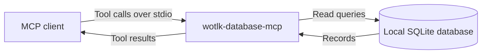

<div align="center">

# wotlk-database-mcp

**Give your AI agent offline access to World of Warcraft 3.3.5a data.**

[Features](#features) · [For agents](#for-agents) · [Install](#install) · [Quick start](#quick-start) · [Docs](docs/index.md)

</div>

Look up game records, the Lua API, and native client offsets without web searches. This Model Context Protocol (MCP) server gives AI agents local reference data for original WotLK, client build 12340.

## How it works

Your MCP client calls the server over stdio, and the server reads a local SQLite database.



## Features

Use the server to find records and follow their links.

- **Query offline.** The server needs no network connection at runtime.
- **Find game data.** Search items, spells, creatures, quests, and other game records by name.
- **Follow relationships.** Find loot sources, vendors, trainers, quest chains, and spell ranks.
- **Check client interfaces.** Look up Lua API records and Windows x86 offsets with verification status.
- **Read without changes.** Use `search`, `get`, `related`, or read-only `sql` queries.

## Supported platforms

The setup scripts support these build environments.

| Platform | Build environment |
| --- | --- |
| macOS | Bash and Homebrew |
| Linux | Bash with apt, dnf, or pacman |
| Windows x86_64 | MSYS2 UCRT64 Bash and Microsoft C++ Build Tools |

## For agents

Paste this prompt into your AI agent. It installs the prerequisites, builds the server, and registers it in the agent's harness.

```text
Install the wotlk-database MCP server for this harness. Follow every step in
https://github.com/denisdasilvarocha/wotlk-database-mcp/blob/main/docs/install.md
exactly: install the prerequisites, clone and build the repository, register the
server in this harness's MCP configuration with absolute paths, then run the
verification step. Keep the existing MCP servers. Report the paths you used and
the verification result.
```

## Install

Install from source with the [platform prerequisites](docs/install.md#1-install-prerequisites).

> [!IMPORTANT]
> This repository is private. You need repository access before you can clone it.

<details open>
<summary><b>macOS</b></summary>

After you install the prerequisites, clone the repository and prepare the tools:

```sh
git clone https://github.com/denisdasilvarocha/wotlk-database-mcp.git
cd wotlk-database-mcp
just setup
```

</details>

<details>
<summary><b>Linux</b></summary>

After you install the prerequisites, run these commands in Bash:

```sh
git clone https://github.com/denisdasilvarocha/wotlk-database-mcp.git
cd wotlk-database-mcp
just setup
```

</details>

<details>
<summary><b>Windows x86_64</b></summary>

After you install the prerequisites, run these commands in the MSYS2 UCRT64 terminal:

```sh
git clone https://github.com/denisdasilvarocha/wotlk-database-mcp.git
cd wotlk-database-mcp
just setup
```

</details>

## Quick start

Build the database and server from the repository root:

```sh
just build
```

Add this entry under `mcpServers` in your MCP client configuration. Keep your existing entries, and replace both paths with absolute paths into your checkout:

```json
{
  "mcpServers": {
    "wotlk-database": {
      "command": "/absolute/path/to/wotlk-database-mcp/target/release/wotlk-database-mcp",
      "args": ["--db", "/absolute/path/to/wotlk-database-mcp/data/wotlk.sqlite"]
    }
  }
}
```

On Windows, add `.exe` to the command and use forward slashes, for example `C:/src/wotlk-database-mcp/data/wotlk.sqlite`.

Reconnect the client, then call the `sql` tool with these arguments:

```json
{"query": "SELECT 1 AS ok"}
```

The tool returns a header and one row:

```text
ok
1
```

For registration steps and connection errors, see [Install the server](docs/install.md).

## Documentation

Choose a page for your task.

- [Documentation index](docs/index.md)
- [Install the server](docs/install.md)
- [Tools reference](docs/reference/tools.md)
- [Configuration reference](docs/reference/configuration.md)
- [Rebuild the database](docs/guides/rebuild-database.md)
- [Architecture](docs/architecture.md)
- [Changelog](CHANGELOG.md)

## Development

The project requires Rust 1.99 or later. After setup, run the server from source:

```sh
just run
```

Run the tests:

```sh
just test
```

## Contributing

Read [Contributing](CONTRIBUTING.md) for setup, conventions, and checks.

## Community

Use [Issues](https://github.com/denisdasilvarocha/wotlk-database-mcp/issues) to report bugs or ask questions.
