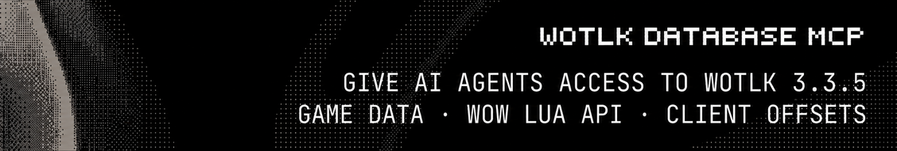

<p align="center">
  <a href="#features">Features</a> ·
  <a href="#prerequisites">Prerequisites</a> ·
  <a href="#install">Install</a> ·
  <a href="#usage">Usage</a> ·
  <a href="#development">Development</a> ·
  <a href="#documentation">Documentation</a> ·
  <a href="#license">License</a>
</p>

<p align="center">
  <a href="https://registry.npmjs.org/wotlk-database-mcp"></a>
  <a href="https://www.rust-lang.org/"></a>
  <a href="LICENSE"></a>
</p>

WotLK Database MCP is an [MCP](https://modelcontextprotocol.io/) server for World of Warcraft: Wrath of the Lich King 3.3.5a (client build 12340). It gives MCP clients access to game records, their relationships, Lua and addon API data, and client offsets through a read-only SQLite database.

## Features

- Search and retrieve items, item sets, creatures, spells, quests, game objects, maps, areas, factions, talents, skills, glyphs, and achievements.
- Inspect record details such as item stats, spell effects, and quest objectives.
- Find loot and drop chances, vendors and prices, trainers, creature and game-object spawns, quest chains and rewards, spell ranks, and achievement criteria.
- Look up Lua functions and signatures, events and their parameters, widgets, CVars, Lua types, combat-log events, and secure templates.
- Inspect Windows x86 addresses, verification status, and comments for build 12340. Only offsets marked `verified` are confirmed; check the comments for caveats.
- Run read-only SQL queries, including queries against tables not exposed as record types.

The database combines client DBC data, TrinityCore world data, and vendored Lua API and offset catalogs. It is a snapshot, so data on a customized server may differ. Call `get` with `{"kind": "meta"}` to inspect the database's provenance.

## Prerequisites

- An MCP client that supports [stdio transport](https://modelcontextprotocol.io/specification/2025-06-18/basic/transports#stdio).
- Node 22 or later. Native packages support macOS and Linux, Windows.

## Install

Run the command for your client in a terminal.

<details>
<summary>Codex</summary>

```bash
codex mcp add wotlk-database -- npx -y wotlk-database-mcp
```

[Codex MCP documentation](https://learn.chatgpt.com/docs/extend/mcp).

</details>

<details>
<summary>Claude Code</summary>

```bash
claude mcp add --transport stdio --scope user wotlk-database -- npx -y wotlk-database-mcp
```

[Claude Code MCP documentation](https://code.claude.com/docs/en/mcp).

</details>

<details>
<summary>Cursor</summary>

The Cursor CLI shares its MCP configuration with the editor:

```bash
agent mcp add wotlk-database -- npx -y wotlk-database-mcp
```

[Cursor MCP documentation](https://cursor.com/docs/integrations/xcode).

</details>

<details>
<summary>Hermes Agent</summary>

```bash
hermes mcp add wotlk-database --command npx --args -y wotlk-database-mcp
```

Follow the prompts to select the tools and save the server.

[Hermes Agent MCP documentation](https://hermes-agent.nousresearch.com/docs/reference/cli-commands#hermes-mcp).

</details>

<details>
<summary>OpenClaw</summary>

If the local gateway is running, stop it before registration and start it again afterward.

```bash
openclaw mcp add wotlk-database --command npx --arg -y --arg wotlk-database-mcp
```

[OpenClaw MCP documentation](https://docs.openclaw.ai/cli/mcp/registry).

</details>

<details>
<summary>OpenCode</summary>

In OpenCode v2, run this from your project:

```bash
opencode mcp add wotlk-database -- npx -y wotlk-database-mcp
```

Add `--global` before `--` to make the server available in every project. For OpenCode v1, run `opencode mcp add` and follow the prompts for a local server named `wotlk-database` with the command `npx -y wotlk-database-mcp`.

[OpenCode MCP documentation](https://dev.opencode.ai/v2/docs/mcp-servers/).

</details>

<details>
<summary>Pi</summary>

Pi 0.99.0 or later includes MCP support:

```bash
pi mcp add wotlk-database -- npx -y wotlk-database-mcp
```

[Pi MCP documentation](https://pi.dev/docs/latest/mcp).

</details>

<details>
<summary>Oh My Pi (OMP)</summary>

Start `omp`, then run `/mcp add` in the session. In the setup wizard, use the name `wotlk-database`, choose stdio, enter `npx` as the command and `-y wotlk-database-mcp` as the arguments, and select your preferred scope.

[Oh My Pi (OMP) MCP documentation](https://github.com/can1357/oh-my-pi/blob/main/docs/mcp-config.md).

</details>

<details>
<summary>GitHub Copilot CLI</summary>

```bash
copilot mcp add wotlk-database -- npx -y wotlk-database-mcp
```

[GitHub Copilot CLI MCP documentation](https://docs.github.com/en/copilot/how-tos/copilot-cli/customize-copilot/add-mcp-servers).

</details>

<details>
<summary>Other</summary>

Give your agent this prompt to configure the server for its MCP client:

```text
Install and configure the WotLK Database MCP server for this agent. Preserve my
existing MCP servers and adapt this stdio configuration to the client's format:

{
  "mcpServers": {
    "wotlk-database": {
      "command": "npx",
      "args": ["-y", "wotlk-database-mcp"]
    }
  }
}

Reload the MCP configuration if needed, then verify the server connects and
list its available tools.
```

</details>

> [!NOTE]
> Restart or reconnect the client, then ask it to search the WotLK database for an item or spell. On the first run, the server downloads and verifies the database in the background and stores it in a versioned platform cache. If a tool reports download progress, retry after the download finishes.

To prepare the cache before connecting, run:

```bash
npx -y wotlk-database-mcp fetch
```

For a local database, pass `--db /path/to/wotlk.sqlite` after the package name, or set `WOTLK_DB` in the server's environment. See [installation and configuration](docs/install.md) for details and source builds.

## Usage

| Tool      | Purpose                                                    |
| --------- | ---------------------------------------------------------- |
| `search`  | Find records by name, optionally filtered by kind.         |
| `get`     | Retrieve a record and optionally select additional fields. |
| `related` | Follow a supported relationship from a record.             |
| `sql`     | Run one read-only SQLite statement.                        |

To find Frostbolt, call `search` with:

```json
{ "text": "Frostbolt", "kind": "spell" }
```

Then call `related` with a spell ID from the results to list its ranks:

```json
{ "kind": "spell", "id": 116, "relation": "ranks" }
```

Your MCP client can use these tools to answer questions such as:

- What are the stats for Thunderfury, Blessed Blade of the Windseeker?
- Where does Ragnaros spawn, and what loot can it drop?
- What are the rewards and follow-up quests for The Missing Diplomat?
- What is the spell ID for Frostbolt rank 3?
- What does `UnitHealth` return?
- What is the offset for `FrameScript::Execute`?

See the [tool reference](docs/tools.md) for parameters, examples, relationships, and data conventions.

## Development

The Rust workspace contains the server and the database builder. Install [just](https://just.systems/), then run `just setup` to install missing development tools and hooks. The setup script supports macOS, Linux with apt, dnf or pacman, and Windows through MSYS2 UCRT64. It may install system packages and Rust tools.

```bash
just setup
just build
just run
```

`just build` prepares the pinned inputs, builds `data/wotlk.sqlite`, and compiles the release server. `just run` starts the server with that database on stdio. Run `just test` for workspace and database build script tests, or `just check` for the full hook suite. See the [development guide](docs/development.md) for prerequisites and the separate npm packaging check.

### Documentation

- [Installation and configuration](docs/install.md)
- [Tool reference](docs/tools.md)
- [Development guide](docs/development.md)

## License

MIT. See [LICENSE](LICENSE).
