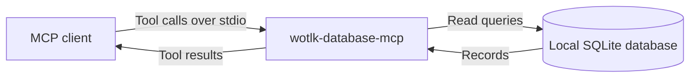

<div align="center">

# wotlk-database-mcp

**Give your AI agent offline access to World of Warcraft 3.3.5a data.**

[Features](#features) · [For agents](#for-agents) · [Install](#install) · [Quick start](#quick-start) · [Docs](docs/index.md)

</div>

Look up game records, the Lua API, and native client offsets without web searches. This Model Context Protocol (MCP) server gives AI agents local reference data for original WotLK, client build 12340.

## How it works

Your MCP client calls the server over stdio, and the server reads a local SQLite database.



## Features

Use the server to find records and follow their links.

- **Query offline.** Queries need no network connection after the database download.
- **Find game data.** Search items, spells, creatures, quests, and other game records by name.
- **Follow relationships.** Find loot sources, vendors, trainers, quest chains, and spell ranks.
- **Check client interfaces.** Look up Lua API records and Windows x86 offsets with verification status.
- **Read without changes.** Use `search`, `get`, `related`, or read-only `sql` queries.

## Supported platforms

The npm package supports these platforms without Rust or an install script.

| Platform | Architectures |
| --- | --- |
| macOS | ARM64 and x86_64 |
| Linux | x86_64 and ARM64 (GNU targets) |
| Windows | x86_64 |

## For agents

Paste this prompt into your AI agent to register the server.

```text
Install the wotlk-database MCP server for this harness. Follow:
https://github.com/denisdasilvarocha/wotlk-database-mcp/blob/main/docs/install.md
Use the npx configuration. Keep the existing MCP servers. Run the verification
step and report the result.
```

## Install

Install Node.js with npm and `npx`. Add this entry to your MCP client configuration. Keep your existing MCP servers.

```json
{
  "mcpServers": {
    "wotlk-database": {
      "command": "npx",
      "args": ["-y", "wotlk-database-mcp"]
    }
  }
}
```

## Quick start

To download and verify the database before you connect, run:

```sh
npx -y wotlk-database-mcp fetch
```

You can also connect at once. The server answers the handshake and lists tools before the first download finishes. Tools return a downloading error with a percentage until the database is ready. Retry the call after the download. You do not need to restart the server.

The cache file for schema version 1 uses these locations:

| Platform | Cache file |
| --- | --- |
| macOS | `~/Library/Caches/wotlk-database-mcp/schema-1/wotlk.sqlite` |
| Linux | `$XDG_CACHE_HOME/wotlk-database-mcp/schema-1/wotlk.sqlite`, or `~/.cache/wotlk-database-mcp/schema-1/wotlk.sqlite` when unset |
| Windows | `%LOCALAPPDATA%/wotlk-database-mcp/schema-1/wotlk.sqlite` |

To use a local file, set `WOTLK_DB` or pass `--db /absolute/path/to/wotlk.sqlite`. `--db` takes precedence. Explicit paths never download a database.

For a manual download, use the [release asset and decompression steps](docs/install.md#download-manually). The URL uses `db-schema<N>/wotlk-schema<N>.sqlite.zst`, with schema version `1` today. Run `zstd -d` on the asset and set `WOTLK_DB` to the decompressed file.

Set `HTTPS_PROXY` or `https_proxy` in the server environment if downloads require a proxy.

Reconnect the client, then call the `sql` tool with these arguments:

```json
{"query": "SELECT 1 AS ok"}
```

The tool returns a header and one row:

```text
ok
1
```

For registration steps and connection errors, see [Install the server](docs/install.md).

## Documentation

Choose a page for your task.

- [Documentation index](docs/index.md)
- [Install the server](docs/install.md)
- [Tools reference](docs/reference/tools.md)
- [Configuration reference](docs/reference/configuration.md)
- [Rebuild the database](docs/guides/rebuild-database.md)
- [Architecture](docs/architecture.md)
- [Changelog](CHANGELOG.md)

## Development

The project requires Rust 1.99 or later. Follow the [source build steps](docs/install.md#5-build-from-source), then run:

```sh
just run
```

`just run` passes `--db data/wotlk.sqlite`. You can also run:

```sh
cargo run -- --db data/wotlk.sqlite
```

Run the tests:

```sh
just test
```

## Contributing

Read [Contributing](CONTRIBUTING.md) for setup, conventions, and checks.

## Community

Use [Issues](https://github.com/denisdasilvarocha/wotlk-database-mcp/issues) to report bugs or ask questions.
