# Architecture

The server provides local reference data for World of Warcraft 3.3.5a, client build 12340. This page explains the build boundary, the runtime boundary, and the source rules.

## Scope and boundary

The builder converts local source files into one SQLite database. The server reads that database and answers Model Context Protocol (MCP) requests over standard input and standard output.

The server does not connect to a game client or a game server. It can download a database release into the user cache. Build scripts can download inputs before the builder runs.

## Components

The database separates source import from MCP requests. The client exchanges JSON-RPC messages with the server over stdio.

```mermaid
flowchart LR
  accTitle: Database build, distribution, and MCP runtime
  accDescr: The builder writes SQLite. A release can supply the user cache. The server reads a local database and answers MCP requests over stdio.
  inputs["TDB, DBC, offsets, and Lua API files"] -->|import| builder["wotlk-db-builder"]
  builder -->|write| database[("data/wotlk.sqlite")]
  database -->|publish compressed asset| release["GitHub Release"]
  release -->|download and verify| cache[("User cache")]
  cache -->|read only| server
  database -->|read only| server["wotlk-database-mcp"]
  server <-->|"JSON-RPC over stdio"| client["MCP client"]
```

## Responsibilities

The Cargo workspace contains the server crate and the builder crate. These directories separate runtime code, import code, tests, and development commands.

| Directory | Responsibility |
| --- | --- |
| `src/` | MCP tools, database queries, record kinds, and output formatting. |
| `builder/` | Source parsers, data import, schema creation, search index creation, and vendored inputs. |
| `tests/` | Server integration tests, builder fixtures, and database build script tests. |
| `scripts/` | Development setup, pinned input downloads, archive checks, and vendor updates. |

## Data and control flow

The builder validates required input paths before it creates an output file. It then imports data in this order:

1. Read the client DBC files.
2. Read the selected TDB tables.
3. Read the offsets catalog.
4. Read the Lua API export.
5. Create the search index and provenance records.
6. Commit the transaction and compact the database.

The builder writes a `.partial` file beside the output. It replaces the output after a successful build. On failure, it removes the partial file and preserves the previous output.

At runtime, the server opens one read-only connection. A mutex serializes database access. The server sends query work to `tokio::task::spawn_blocking` so synchronous SQLite calls run outside async tasks.

When stdin closes, the server allows up to five seconds for pending replies. It then exits without waiting for queued SQLite work or a blocked database download.

The server selects `--db`, then `WOTLK_DB`, then the cache for schema version 1. Explicit paths never download. The server checks `meta.schema_version` before it accepts a database.

On a cache miss, the server starts the download on a background thread at startup. The handshake and tool list do not wait for it. Its database state is downloading, ready, or failed. Tool calls report download progress until the database is ready. Download failures become tool errors with recovery steps.

The download process locks the cache, checks it again, and decompresses into `wotlk.sqlite.partial`. It verifies the decompressed file against the SHA-256 checksum embedded in the binary. It syncs the file and renames it to the final cache path. Concurrent processes share the same lock. A new attempt replaces a partial file left by an interrupted download.

## Data sources and pins

The DBC files define client data. TDB supplies world and server-side data that the DBC files do not provide.

| Source | Role | Pin |
| --- | --- | --- |
| TrinityCore TDB 335.26091 | Creature and gameobject data, quests, loot, spawns, vendors, trainers, and item stats. | The build script pins the release archive and its SHA-256 digest. |
| `wowgaming/client-data` v20.0 | Client DBC files for build 12340 with enUS text. | The build script pins `Data.zip` and its SHA-256 digest. |
| `Shard-MW/milkyway-codex` | Lua functions, events, widgets, CVars, types, combat-log data, and secure templates. | `builder/vendor/api/COMMIT` contains `e4e31fb62be318fd7403152aa73b33ef6c70f5fa`. |
| Bundled Windows x86 offsets | Client addresses, status, and source comments. | `builder/vendor/offsets/VERSION` contains the snapshot date `2026-11-01`. |

The [configuration reference](reference/configuration.md) lists the download settings and their defaults. The [database rebuild guide](guides/rebuild-database.md) explains how to update inputs.

Spells come from the DBC files, not from TDB `spell_dbc`. Items use TDB `item_template` stats. `Item.dbc` supplies class and display data for items absent from `item_template`.

The builder checks DBC layouts and requires spell 133 to have the enUS name `Fireball`. These checks detect incompatible inputs. They do not prove Blizzard provenance. Archive hashes detect changes to the pinned downloads, not their original source.

The database stores the schema version, client build, TDB release, dump hash, API commit, offsets snapshot date, and builder version in `meta`.

## TDB parser rules

The builder reads the SQL dump as a stream. It does not execute the dump or require a MySQL service.

| Area | Rule |
| --- | --- |
| Table selection | Parse requested tables. Skip other statements through their terminating semicolon. Require every requested table definition. |
| Names | Match keywords, table names, and column names without ASCII case sensitivity. Accept bare names and backtick-quoted identifiers. |
| Definitions | Read column order from `CREATE TABLE`, with optional `IF NOT EXISTS`. Skip table constraints. Reject duplicate definitions and duplicate column names. |
| Inserts | Require `CREATE TABLE` before `INSERT`. Accept optional `LOW_PRIORITY`, `DELAYED`, `HIGH_PRIORITY`, and `IGNORE` modifiers. Accept `VALUE` or `VALUES` and multiple rows. |
| Column lists | Use definition order unless an insert supplies a column list. Reject unknown or duplicate columns. Require the importer’s required columns in both forms. |
| Row values | Accept quoted strings, numeric words, and SQL `NULL`. Require one value per listed column. Reject expressions and other value forms. |
| Strings | Accept single or double quotes and doubled quote characters. Decode MySQL backslash escapes. Preserve the backslash before `%` and `_`. |
| Comments | Skip `#` and `--` line comments and `/* ... */` block comments. Treat versioned MySQL block comments as comments, not executable SQL. |
| Text encoding | Validate UTF-8 throughout the stream, including skipped input. Reject invalid or incomplete sequences. |
| Cell conversion | Convert numeric `NULL` to zero. Convert text `NULL` and empty strings to absent values. Reject invalid numeric conversions. |
| Errors | Report malformed input with a one-based dump line number. Reject incomplete statements, comments, strings, and rows. |

## Decisions and constraints

The local database keeps queries independent of source services after the first download. Data changes require a database rebuild and a matching release asset, not live source queries.

The server uses SQLite read-only open flags and enables `query_only`. Its authorizer blocks transaction control, database attachment, and disallowed pragma assignments. These controls protect the database connection. They do not isolate the process from the host operating system.

> [!IMPORTANT]
> Standard output carries MCP JSON-RPC frames. Extra output corrupts the protocol. Server diagnostics use `tracing` and go to standard error.

Client DBC data remains the source of truth for client-defined records. TDB adds server data. The item import rules above preserve the stats that only TDB provides.

For tool behavior and query limits, see the [tool reference](reference/tools.md). For the design rationale and detailed requirements, see the [data server specification](spec/wotlk-data-server.md).
