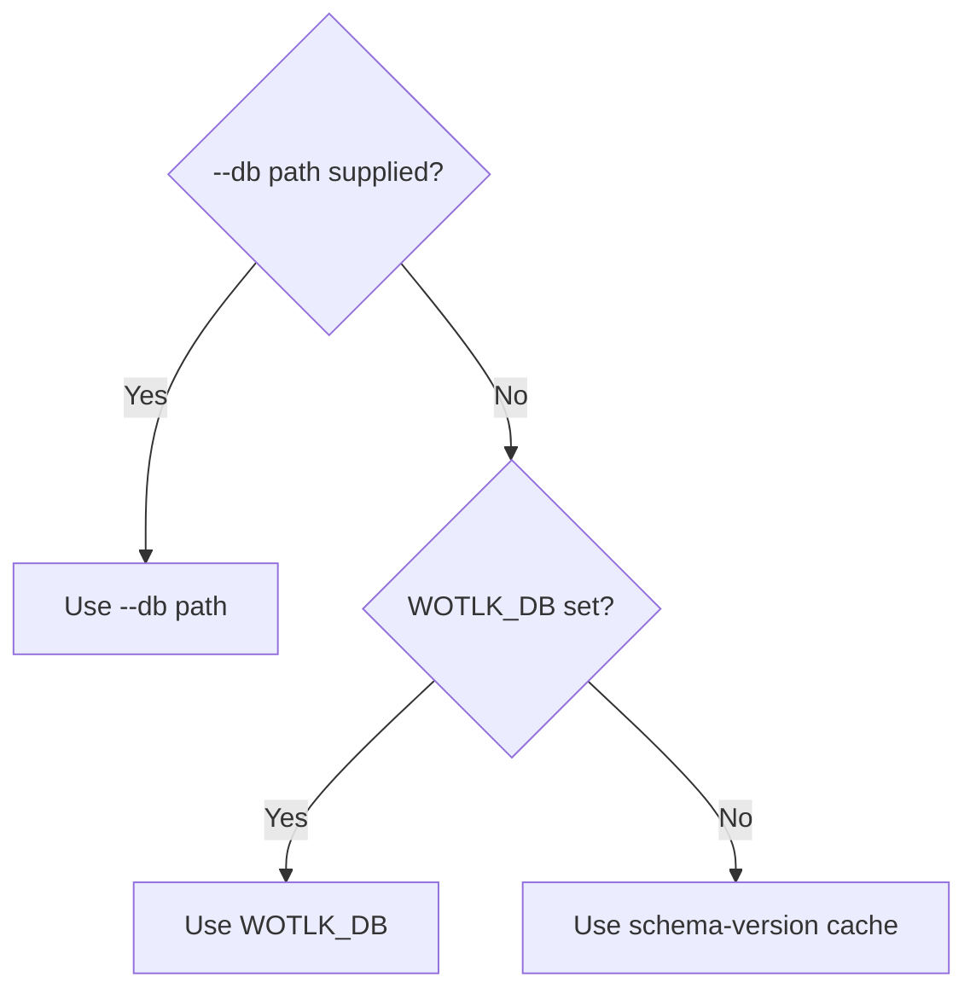

# Configuration reference

This page defines runtime and database-build settings for server 0.1.0. The database targets World of Warcraft 3.3.5a, client build 12340.

## Sources

The server reads a command-line database path, environment variables, and the user cache. The database build script reads its input settings from environment variables.

| Source | Scope | Behavior |
| --- | --- | --- |
| `--db` command-line option | Server database path | Overrides `WOTLK_DB` and the cache. |
| `WOTLK_DB` environment variable | Server database path | Used when `--db` is absent. |
| User cache | Server database path | Used when neither override is present. |
| `RUST_LOG` environment variable | Server logging | Sets the tracing filter. |
| Build environment variables | Database input archives | Override the defaults in `scripts/build_db.sh`. |

The server has no configuration file or authentication setting.

## Database path precedence

The server selects `--db` first, then `WOTLK_DB`, then the schema-version cache. An invalid explicit path causes an error that names the path. Explicit paths never trigger a download or fall back to the cache.



The cache path ends with `wotlk-database-mcp/schema-2/wotlk.sqlite` under the platform cache directory. See [cache locations](../install.md#2-download-the-database) for each OS. The server does not use a path from the source checkout unless you select it explicitly.

## Runtime settings

The server accepts these command-line forms. Replace `<path>` with the database file path.

```text
wotlk-database-mcp [--db <path>]
wotlk-database-mcp fetch
```

| Name | Type | Required | Default | Meaning |
| --- | --- | --- | --- | --- |
| `--db <path>` | Path argument | No | `WOTLK_DB`, then cache | Selects an existing database file. |
| `WOTLK_DB` | Environment path | No | Cache | Selects the database when `--db` is absent. |
| `RUST_LOG` | Environment string | No | `INFO` filter directive | Sets the tracing log filter. |
| `HTTPS_PROXY` or `https_proxy` | Environment URL | No | No explicit proxy | Sets the proxy for database downloads. |

`--db` requires exactly one path argument. Unknown flags, missing paths, and extra arguments fail with this usage text:

```text
usage: wotlk-database-mcp [--db <path>] | wotlk-database-mcp fetch
```

`fetch` downloads and verifies the cached database. It reports progress on stderr and exits with code 0 on success. It exits non-zero on failure. A valid cache needs no download.

Relative paths resolve from the server process's working directory. An empty `WOTLK_DB` counts as a selected value and fails the file check.

The server opens the database read-only. It requires `meta.schema_version` to equal `2`, including for explicit paths. A missing version produces `expected schema version 2, found none`. A different version produces `expected schema version 2, found <x>`, where `<x>` is the stored value.

With no valid cache, the server answers the handshake and lists tools before it downloads the database. During the download, tool errors give a percentage and tell the caller to retry. After the database is ready, tools work without a restart.

If download or verification fails, tool errors include the cause, asset URL, `npx wotlk-database-mcp fetch`, and the `WOTLK_DB` manual-download option. A build without an embedded checksum cannot download. It still serves the handshake and tool list. Use an explicit database or a valid cache.

| Startup error | Caller action |
| --- | --- |
| `usage: wotlk-database-mcp [--db <path>] \| wotlk-database-mcp fetch` | Supply no arguments, `--db` with one path, or `fetch`. |
| `database file not found: PATH (pass --db <path> or set WOTLK_DB)` | Select an existing database file. See [Installation](../install.md). |
| `cannot open database PATH` | Check file access and the SQLite error. Use a database that contains build metadata. |
| `expected schema version 2, found ...` | Run `just build-db` or download schema version 2. |

## Logging

The server uses the tracing environment filter from `RUST_LOG`. It parses the filter with `from_env_lossy()` and uses `INFO` as the default directive.

Logs go to standard error without ANSI color. The startup log includes the selected database path.

> [!IMPORTANT]
> Standard output carries MCP protocol frames. Send diagnostic output to standard error through `tracing`.

## Database build settings

`scripts/build_db.sh` reads the six environment variables below. An unset or empty value uses the listed default. These settings change database inputs, not runtime database selection.

> [!WARNING]
> An archive override changes the input data. Set the matching SHA-256 digest and archive member for that input. The script rejects checksum mismatches.

| Name | Type | Required | Default | Meaning |
| --- | --- | --- | --- | --- |
| `TDB_URL` | URL string | No | `https://github.com/TrinityCore/TrinityCore/releases/download/TDB335.26091/TDB_full_world_335.26091_2026_09_09.7z` | TrinityCore world-data archive URL. |
| `TDB_SHA256` | SHA-256 hex string | No | `ed0c50177da912b50c9f386ba8a26254cecfb997ca7fd2e992c25b344e11274f` | Expected digest of the TDB archive. |
| `TDB_MEMBER` | Archive member string | No | `TDB_full_world_335.26091_2026_09_09.sql` | SQL dump member to extract. |
| `DBC_URL` | URL string | No | `https://github.com/wowgaming/client-data/releases/download/v20.0/Data.zip` | Client DBC archive URL. |
| `DBC_SHA256` | SHA-256 hex string | No | `a3d4df635ae6c2c8f08052c32a79e0f806955150ad36b014a823dd08a32a4610` | Expected digest of the DBC archive. |
| `DBC_MEMBER` | Archive directory string | No | `dbc` | Top-level directory that contains the DBC files. Matching ignores case. |

The build script verifies downloaded and cached archives against their expected digests. It extracts the selected TDB member as `world.sql`. It selects direct `.dbc` members from the configured DBC directory.

## Related pages

[Installation](../install.md) describes server setup. [Rebuild the database](../guides/rebuild-database.md) describes input overrides and rebuild commands. [Tool reference](tools.md) defines the MCP interface.
