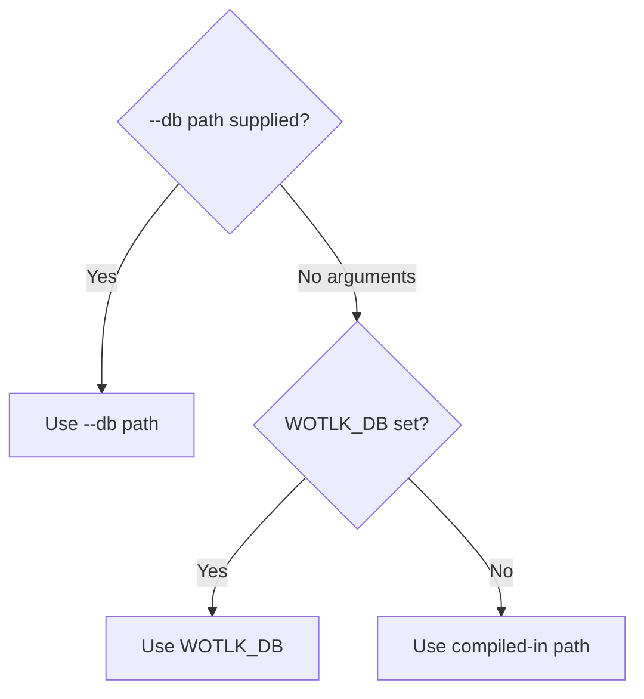

# Configuration reference

This page defines runtime and database-build settings for server 0.1.0. The database targets World of Warcraft 3.3.5a, client build 12340.

## Sources

The server reads a command-line database path, environment variables, and a compiled-in database path. The database build script reads its input settings from environment variables.

| Source | Scope | Behavior |
| --- | --- | --- |
| `--db` command-line option | Server database path | Overrides `WOTLK_DB` and the compiled-in path. |
| `WOTLK_DB` environment variable | Server database path | Used only when the command line has no arguments. |
| Compiled-in path | Server database path | Used when neither database override is present. |
| `RUST_LOG` environment variable | Server logging | Sets the tracing filter. |
| Build environment variables | Database input archives | Override the defaults in `scripts/build_db.sh`. |

The server has no configuration file or authentication setting.

## Database path precedence

The server selects `--db` first, then `WOTLK_DB`, then the compiled-in path. An invalid selected path causes an error. It does not fall back to another source.

The compiled-in path is `CARGO_MANIFEST_DIR/data/wotlk.sqlite`. Here, `CARGO_MANIFEST_DIR` is the source directory at compilation time. It is not the current working directory or the executable directory.

## Runtime settings

The command-line form is `wotlk-database-mcp [--db <path>]`. The `<path>` value is the database file path.

| Name | Type | Required | Default | Meaning |
| --- | --- | --- | --- | --- |
| `--db <path>` | Path argument | No | `WOTLK_DB`, then the compiled-in path | Selects an existing database file. |
| `WOTLK_DB` | Environment path | No | Compiled-in path | Selects the database when no command-line arguments are present. |
| `RUST_LOG` | Environment string | No | `INFO` filter directive | Sets the tracing log filter. |

`--db` requires exactly one path argument. Unknown flags, missing paths, and extra arguments fail with `usage: wotlk-database-mcp [--db <path>]`. The server has no `--help` option.

Relative paths resolve from the server process's working directory. An empty `WOTLK_DB` counts as a selected value and fails the file check.

The server requires a file at the selected path. It opens the database read-only and reads the `client_build` entry from `meta` during startup.

| Startup error | Caller action |
| --- | --- |
| `usage: wotlk-database-mcp [--db <path>]` | Supply no arguments, or supply `--db` followed by one path. |
| `database file not found: PATH (pass --db <path> or set WOTLK_DB)` | Select an existing database file. See [Installation](../install.md). |
| `cannot open database PATH` | Check file access and the SQLite error. Use a database that contains build metadata. |

## Logging

The server uses the tracing environment filter from `RUST_LOG`. It parses the filter with `from_env_lossy()` and uses `INFO` as the default directive.

Logs go to standard error without ANSI color. The startup log includes the selected database path.

> [!IMPORTANT]
> Standard output carries MCP protocol frames. Send diagnostic output to standard error through `tracing`.

## Database build settings

`scripts/build_db.sh` reads the six environment variables below. An unset or empty value uses the listed default. These settings change database inputs, not runtime database selection.

> [!WARNING]
> An archive override changes the input data. Set the matching SHA-256 digest and archive member for that input. The script rejects checksum mismatches.

| Name | Type | Required | Default | Meaning |
| --- | --- | --- | --- | --- |
| `TDB_URL` | URL string | No | `https://github.com/TrinityCore/TrinityCore/releases/download/TDB335.26091/TDB_full_world_335.26091_2026_09_09.7z` | TrinityCore world-data archive URL. |
| `TDB_SHA256` | SHA-256 hex string | No | `ed0c50177da912b50c9f386ba8a26254cecfb997ca7fd2e992c25b344e11274f` | Expected digest of the TDB archive. |
| `TDB_MEMBER` | Archive member string | No | `TDB_full_world_335.26091_2026_09_09.sql` | SQL dump member to extract. |
| `DBC_URL` | URL string | No | `https://github.com/wowgaming/client-data/releases/download/v20.0/Data.zip` | Client DBC archive URL. |
| `DBC_SHA256` | SHA-256 hex string | No | `a3d4df635ae6c2c8f08052c32a79e0f806955150ad36b014a823dd08a32a4610` | Expected digest of the DBC archive. |
| `DBC_MEMBER` | Archive directory string | No | `dbc` | Top-level directory that contains the DBC files. Matching ignores case. |

The build script verifies downloaded and cached archives against their expected digests. It extracts the selected TDB member as `world.sql`. It selects direct `.dbc` members from the configured DBC directory.

## Related pages

[Installation](../install.md) describes server setup. [Rebuild the database](../guides/rebuild-database.md) describes input overrides and rebuild commands. [Tool reference](tools.md) defines the MCP interface.
